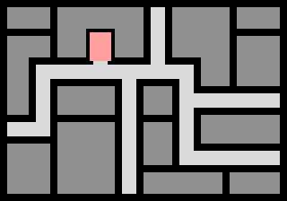

# How to run

1. Install [love2D](https://love2d.org/)
2. Make sure it's globally available on your machine
3. Go on the root path of this project
4. run "love ."

## Level generation

Each stages should look something like the following

